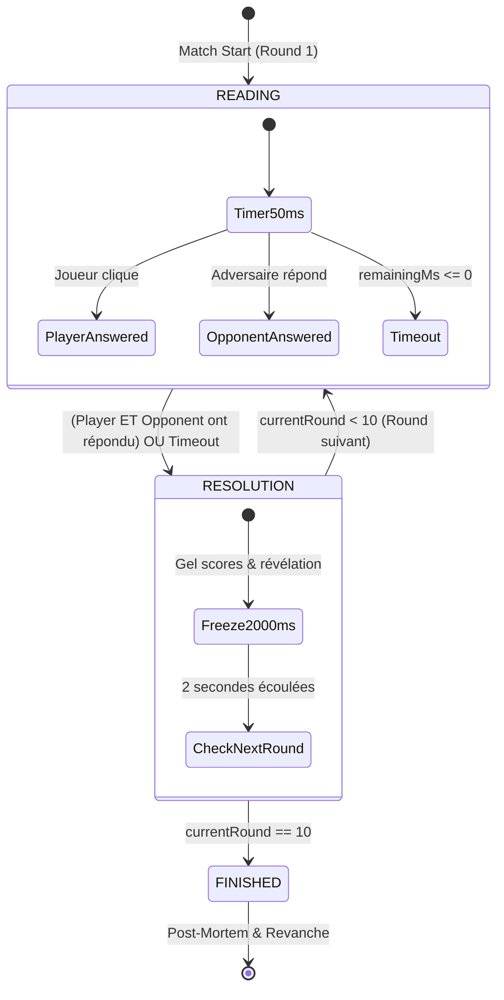

# Spécification Technique : Protocole WebSocket pour le Duel Synchrone 1v1

## 1. Vue d'Ensemble & Objectifs

Ce document décrit l'architecture de transition du mode **Duel Synchrone 1v1** de DEVARENA, passant de la simulation locale autonome (`driver: 'local_bot'`) vers l'infrastructure temps réel distribuée (`driver: 'websocket'`) opérée par le serveur NestJS Gateway (port 3000) et consommée par le client Next.js (port 3001).

L'architecture découple totalement l'interface utilisateur (`DuelArena.tsx`) de la source d'arbitrage grâce au Hook `useQuizDuel` et au pattern Driver.

---

## 2. Machine à États Validée (Arbitre)

Le cycle de vie d'un duel se compose de 10 rounds successifs régis par trois états stricts :



### Règles de transition :
1. **READING (10s max, horloge à 50ms)** :
   - Les participants peuvent soumettre leur réponse une seule fois par round.
   - Dès que le joueur **ET** l'adversaire ont répondu, la phase bascule immédiatement en `RESOLUTION` sans attendre la fin du chrono.
   - Si le chrono atteint `0ms`, tout participant n'ayant pas répondu est considéré en timeout (`selectedIndex: null`, `0 point`).
2. **RESOLUTION (2s de gel strict)** :
   - Horloge gelée, clics désactivés.
   - Mise en évidence visuelle de la bonne réponse (vert émeraude) et des erreurs (rouge/rose).
   - Cumul des points et des temps de réaction.
   - À l'expiration des `2000ms`, passage automatique au round suivant ou bascule vers `FINISHED`.
3. **FINISHED (Écran Post-Mortem)** :
   - Calcul des scores finaux, du taux de précision et des temps moyens de réponse.
   - Détermination du vainqueur (`VICTOIRE`, `DÉFAITE`, `ÉGALITÉ`).

---

## 3. Formule Mathématique de Calcul des Scores

Le barème valorise à la fois l'exactitude algorithmique et la vélocité :

$$\text{Points} = \begin{cases} 
0 & \text{si réponse incorrecte ou timeout} \\
500 + \text{round}\left(\frac{\text{remainingMs}}{10000} \times 500\right) & \text{si réponse correcte}
\end{cases}$$

### Tableau de référence des scores :
| Événement | Temps restant | Temps de réponse | Points attribués |
|---|---|---|---|
| Réponse correcte éclair | 10 000 ms | 0 ms | **1 000 pts** |
| Réponse correcte ultra-rapide | 9 500 ms | 500 ms | **975 pts** |
| Réponse correcte médiane | 5 000 ms | 5 000 ms | **750 pts** |
| Réponse correcte tardive | 2 000 ms | 8 000 ms | **600 pts** |
| Réponse correcte in extremis | 0 ms | 10 000 ms | **500 pts** |
| Réponse incorrecte | N'importe quel temps | N'importe quel temps | **0 pt** |
| Timeout (non répondu) | 0 ms | 10 000 ms | **0 pt** |

---

## 4. Contrats d'Échange WebSocket (NestJS Gateway <-> Next.js)

Le protocole repose sur des payloads JSON typés garantissant l'équité sportive et empêchant la triche (le serveur ne diffuse pas l'index de réponse adverse avant la résolution).

### 4.1. Événements Client -> Serveur (`DuelClientEvent`)

#### `DUEL_JOIN`
Émis par le client dès l'ouverture du socket pour s'enregistrer dans la session de duel.
```json
{
  "type": "DUEL_JOIN",
  "payload": {
    "duelId": "duel_live_8f3a92",
    "playerId": "usr_9921",
    "playerName": "Alice_Dev"
  }
}
```

#### `DUEL_SUBMIT_ANSWER`
Émis dès que le joueur clique sur une option.
```json
{
  "type": "DUEL_SUBMIT_ANSWER",
  "payload": {
    "duelId": "duel_live_8f3a92",
    "roundIndex": 2,
    "questionId": "q3",
    "selectedIndex": 1,
    "timeRemainingMs": 7450
  }
}
```

---

### 4.2. Événements Serveur -> Client (`DuelServerEvent`)

#### `DUEL_ROUND_START`
Diffusé aux deux joueurs pour synchroniser le début d'un round.
```json
{
  "type": "DUEL_ROUND_START",
  "payload": {
    "duelId": "duel_live_8f3a92",
    "roundIndex": 2,
    "question": {
      "id": "q3",
      "prompt": "En TypeScript, quelle est l'utilité de l'opérateur 'satisfies' ?",
      "snippet": "const palette = { primary: '#0070f3' } satisfies Record<string, string>;",
      "options": [
        "Il effectue un cast de type strict au runtime",
        "Il valide la compatibilité sans élargir le type inféré",
        "Il empêche la réassignation des propriétés",
        "Il force le typage dynamique"
      ],
      "correctIndex": 1
    },
    "roundDurationMs": 10000,
    "serverTimestamp": 1776678900000
  }
}
```

#### `DUEL_OPPONENT_ANSWERED`
Diffusé dès que l'adversaire valide son choix (masque la réponse choisie pour éviter la triche par inspection du DOM).
```json
{
  "type": "DUEL_OPPONENT_ANSWERED",
  "payload": {
    "duelId": "duel_live_8f3a92",
    "roundIndex": 2,
    "opponentId": "usr_7714",
    "timeRemainingMs": 6200
  }
}
```

#### `DUEL_ROUND_RESOLVE`
Diffusé dès que les deux participants ont répondu ou que le temps imparti est écoulé. Révèle les choix et les points validés par l'arbitre serveur.
```json
{
  "type": "DUEL_ROUND_RESOLVE",
  "payload": {
    "duelId": "duel_live_8f3a92",
    "roundIndex": 2,
    "correctIndex": 1,
    "playerResult": {
      "selectedIndex": 1,
      "timeRemainingMs": 7450,
      "pointsEarned": 873,
      "isCorrect": true
    },
    "opponentResult": {
      "selectedIndex": 1,
      "timeRemainingMs": 6200,
      "pointsEarned": 810,
      "isCorrect": true
    },
    "playerTotalScore": 2623,
    "opponentTotalScore": 2410
  }
}
```

#### `DUEL_MATCH_END`
Diffusé après la résolution du 10e round avec le récapitulatif complet.
```json
{
  "type": "DUEL_MATCH_END",
  "payload": {
    "duelId": "duel_live_8f3a92",
    "winnerId": "usr_9921",
    "finalStats": {
      "player": {
        "name": "Alice_Dev",
        "totalScore": 7850,
        "correctAnswers": 9,
        "totalResponseTimeMs": 28400,
        "roundScores": [950, 873, 900, 0, 850, 780, 890, 810, 897, 900]
      },
      "opponent": {
        "name": "Bob_Hacker",
        "totalScore": 6420,
        "correctAnswers": 7,
        "totalResponseTimeMs": 35200,
        "roundScores": [850, 810, 0, 750, 0, 820, 790, 0, 800, 800]
      }
    }
  }
}
```

---

## 5. Guide d'Activation Côté Client

Pour basculer le client Next.js du bot autonome vers le serveur WebSocket réel, aucune modification de `DuelArena.tsx` n'est requise. Il suffit de spécifier les options dans `useQuizDuel` ou dans la page serveur `app/(arena)/duel/page.tsx` :

```typescript
const { ... } = useQuizDuel({
  driver: 'websocket',
  socketUrl: process.env.NEXT_PUBLIC_DUEL_WS_URL ?? 'ws://localhost:3000/duel',
  duelId: matchId,
  playerName: user.username,
});
```
